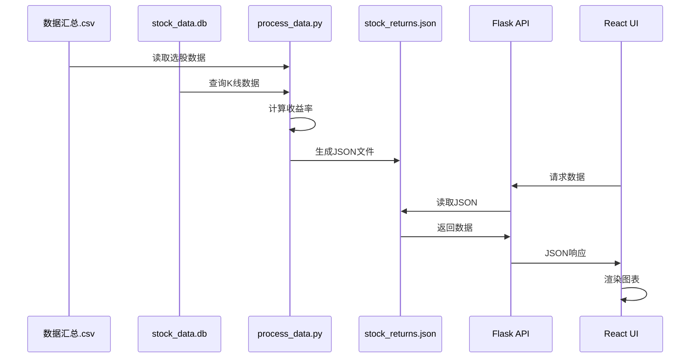
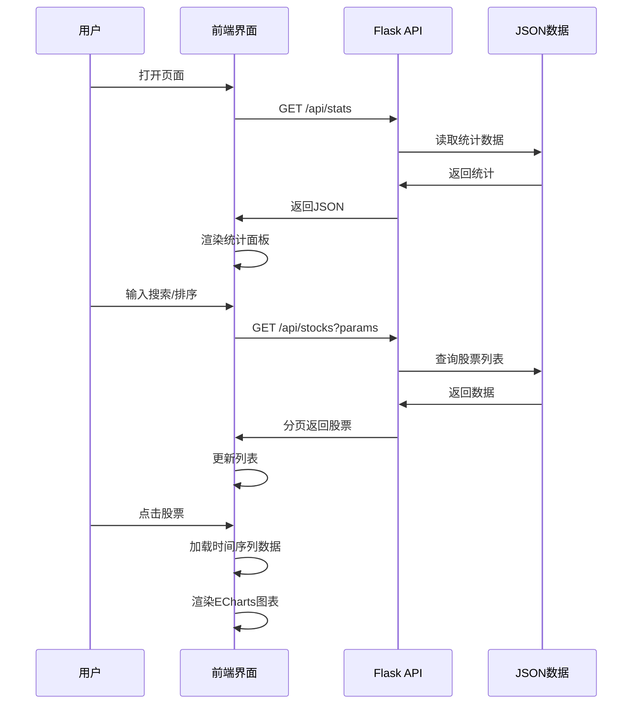
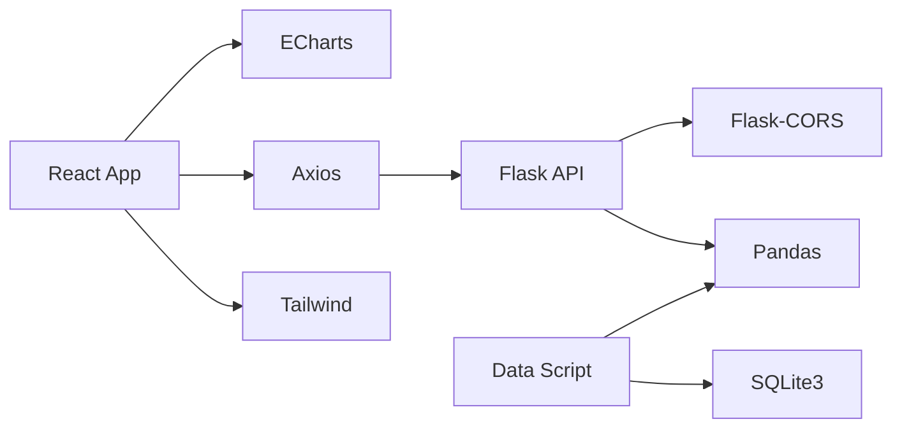

# 系统架构文档

## 概述

股票收益率可视化系统采用前后端分离架构，前端使用 React + Vite，后端使用 Python Flask，通过 RESTful API 进行通信。

## 架构图

```mermaid
graph TB
    subgraph "前端层 Frontend"
        A[用户界面] --> B[React App]
        B --> C[组件层]
        C --> C1[StatsPanel]
        C --> C2[StockList]
        C --> C3[ReturnChart]
        B --> D[API客户端]
        B --> E[ECharts图表]
    end

    subgraph "后端层 Backend"
        F[Flask API服务器]
        F --> G[API路由]
        G --> G1[/health]
        G --> G2[/stats]
        G --> G3[/stocks]
        G --> G4[/stocks/:code]
        G --> G5[/stocks/:code/returns]
        G --> G6[/top]
    end

    subgraph "数据层 Data Layer"
        H[stock_returns.json]
        I[(stock_data.db)]
        J[数据汇总.csv]
    end

    subgraph "数据处理层 Data Processing"
        K[process_data.py]
        K --> L[读取CSV]
        K --> M[查询SQLite]
        K --> N[计算收益率]
        K --> O[生成JSON]
    end

    D <--> F
    F <--> H
    K --> I
    K --> J
    K --> H

    style B fill:#61dafb
    style F fill:#000000,color:#fff
    style H fill:#4caf50,color:#fff
    style K fill:#ff9800,color:#fff
```

## 技术栈

### 前端技术栈

| 技术 | 版本 | 用途 |
|------|------|------|
| React | 18 | UI框架 |
| Vite | 6 | 构建工具 |
| Tailwind CSS | 3 | CSS框架 |
| ECharts | 5 | 图表库 |
| Axios | 1 | HTTP客户端 |
| React Router DOM | 6 | 路由管理（预留） |

### 后端技术栈

| 技术 | 版本 | 用途 |
|------|------|------|
| Python | 3.8+ | 运行环境 |
| Flask | 3 | Web框架 |
| Flask-CORS | 4 | 跨域支持 |
| Pandas | 3 | 数据处理 |
| SQLite | 3 | 数据库 |

## 目录结构

```
shareKLine/
│
├── data/                          # 数据目录
│   └── weipan/                    # 微盘数据
│       ├── 数据汇总.csv           # 选股数据（233条）
│       └── stock_data.db          # K线数据库
│
├── docs/                          # 文档目录
│   ├── architecture.md            # 架构文档（本文档）
│   ├── api.md                     # API文档
│   ├── data-flow.md               # 数据流程图
│   ├── deployment.md              # 部署文档
│   └── user-guide.md              # 用户手册
│
├── scripts/                       # 脚本目录
│   └── process_data.py           # 数据处理脚本
│
├── src/                           # 源代码目录
│   ├── backend/                   # 后端代码
│   │   ├── app.py                # Flask应用入口
│   │   ├── start.sh              # 启动脚本
│   │   └── data/                 # 数据目录
│   │       └── stock_returns.json # 处理后的数据
│   │
│   └── frontend/                  # 前端代码
│       ├── index.html            # HTML入口
│       ├── package.json          # 依赖配置
│       ├── vite.config.js        # Vite配置
│       ├── tailwind.config.js    # Tailwind配置
│       ├── postcss.config.js     # PostCSS配置
│       │
│       ├── src/                  # 源代码
│       │   ├── main.jsx         # React入口
│       │   ├── App.jsx          # 主应用组件
│       │   ├── App.css          # 全局样式
│       │   ├── index.css        # 基础样式
│       │   ├── api.js           # API客户端
│       │   └── components/      # 组件目录
│       │       ├── StatsPanel.jsx   # 统计面板
│       │       ├── StockList.jsx    # 股票列表
│       │       └── ReturnChart.jsx  # 收益率图表
│       │
│       └── public/               # 静态资源
│           └── vite.svg
│
├── venv/                         # Python虚拟环境
│
├── task_plan.md                  # 项目计划
├── findings.md                   # 研究发现
├── progress.md                   # 进度日志
└── README.md                     # 项目说明
```

## 前端架构

### 组件层次结构

```
App
├── Header（头部）
├── StatsPanel（统计面板）
├── StockList（股票列表）
│   └── 表格行
└── ReturnChart（收益率图表）
    └── ECharts
```

### 状态管理

当前使用 React 内置状态管理（useState）：

- `stats`: 统计数据
- `stocks`: 股票列表
- `selectedStock`: 选中的股票
- `loading`: 加载状态
- `error`: 错误信息
- `page`: 当前页码
- `sortBy`: 排序字段
- `order`: 排序方向
- `search`: 搜索关键词

### 路由设计

当前为单页应用，预留路由扩展：

- `/`: 主页（股票列表和图表）
- `/stock/:code`: 股票详情页（待实现）
- `/stats`: 统计页面（待实现）

## 后端架构

### API 设计

RESTful API 设计原则：

1. **统一响应格式**
```json
{
  "data": {...},
  "error": null
}
```

2. **错误处理**
```json
{
  "error": "错误信息"
}
```

3. **分页响应**
```json
{
  "stocks": [...],
  "pagination": {
    "page": 1,
    "page_size": 50,
    "total": 232,
    "total_pages": 5
  }
}
```

### 路由结构

| 路由 | 方法 | 功能 |
|------|------|------|
| `/api/health` | GET | 健康检查 |
| `/api/stats` | GET | 获取统计 |
| `/api/stocks` | GET | 股票列表 |
| `/api/stocks/<code>` | GET | 股票详情 |
| `/api/stocks/<code>/returns` | GET | 收益率曲线 |
| `/api/top` | GET | Top榜单 |

### 数据访问层

当前使用 JSON 文件存储处理后的数据，未来可扩展为：

- 直接访问 SQLite 数据库
- 添加 Redis 缓存层
- 实现数据库连接池

## 数据流架构

### 数据处理流程



### 用户交互流程



## 性能优化

### 前端优化

1. **分页加载**：每页50条记录，减少单次数据传输
2. **虚拟滚动**：预留长列表优化（待实现）
3. **图表懒加载**：仅在选择股票后加载图表
4. **代码分割**：使用 Vite 的代码分割功能

### 后端优化

1. **数据预处理**：提前计算收益率，避免实时计算
2. **文件缓存**：JSON文件读取速度优于数据库查询
3. **分页支持**：减少单次数据传输量

### 未来优化方向

1. **添加 Redis 缓存**
2. **实现 WebSocket 实时更新**
3. **使用 CDN 加速静态资源**
4. **实现服务端渲染（SSR）**

## 安全考虑

1. **CORS 配置**：仅允许前端域名访问
2. **输入验证**：验证所有用户输入
3. **SQL 注入防护**：使用参数化查询
4. **速率限制**：防止API滥用（待实现）

## 扩展性

### 水平扩展

- 前端可部署到 CDN
- 后端可使用负载均衡
- 数据可迁移到分布式数据库

### 功能扩展

- 添加用户认证
- 支持多种数据源
- 添加更多技术指标
- 实现回测功能
- 添加预警系统

## 部署架构

### 开发环境

```
本地开发机
├── 前端：npm run dev (端口 5173)
└── 后端：python app.py (端口 5000)
```

### 生产环境（推荐）

```
Nginx
├── 前端静态文件 (Vite build)
└── 后端 API 反向代理 (Gunicorn + Flask)
```

## 监控与日志

### 前端监控

- 浏览器控制台错误日志
- 性能监控（待实现）
- 用户行为分析（待实现）

### 后端监控

- Flask 日志
- 错误追踪（待实现）
- API 性能监控（待实现）

## 依赖关系



## 总结

本系统采用简洁的前后端分离架构，具有良好的可维护性和扩展性。通过预处理数据减少了实时计算压力，使用主流技术栈保证了开发效率和用户体验。
