# 数据流程文档

## 概述

本文档详细描述股票数据从原始数据到可视化展示的完整流程。

## 系统数据流

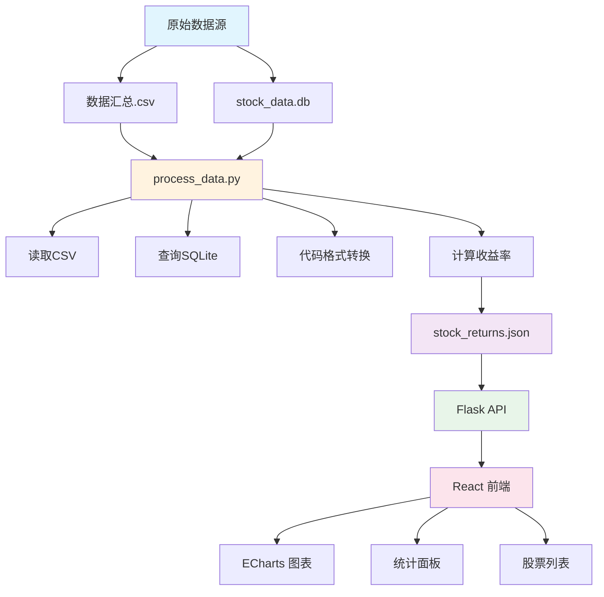

## 数据源详解

### 1. 数据汇总.csv

**文件路径**: `data/weipan/数据汇总.csv`

**数据结构**:
```csv
名称,代码,入选日期+时间,入选价格
迈为股份,300751,2025-12-18 14:46,157.51
```

**字段说明**:
- `名称`: 股票中文名称
- `代码`: 6位股票代码（无市场前缀）
- `入选日期+时间`: 选股时间点（格式：YYYY-MM-DD HH:MM）
- `入选价格`: 买入价格

**数据特征**:
- 总记录数: 233 条
- 时间范围: 2025-10-09 至 2026-01-27
- 重复股票: 同一股票可能多次入选

### 2. stock_data.db

**文件路径**: `data/weipan/stock_data.db`

**数据库结构**:
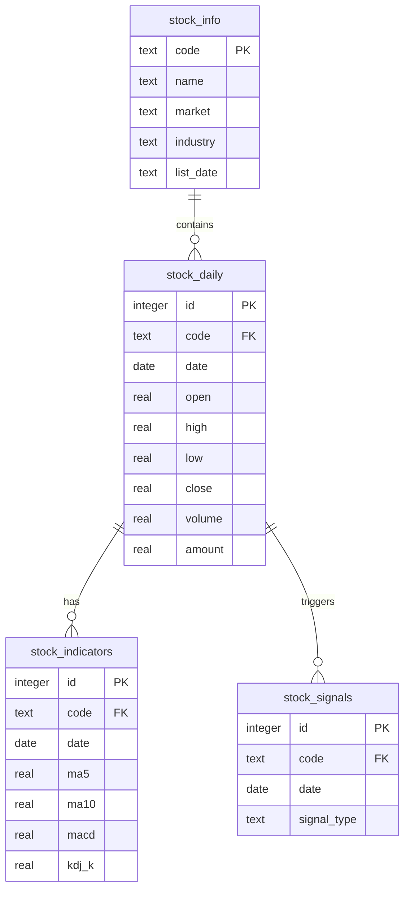

**关键表说明**:

**stock_daily (日线数据)**
- 记录数: 132,143
- 时间粒度: 每日
- 包含字段: 开盘价、最高价、最低价、收盘价、成交量、成交额

**minute_kline (分钟线)**
- 记录数: 675,840
- 时间粒度: 5分钟
- 代码格式: 6位数字（无前缀）

**stock_info (股票信息)**
- 记录数: 10
- 包含股票基本信息

## 数据处理流程

### Phase 1: 数据读取

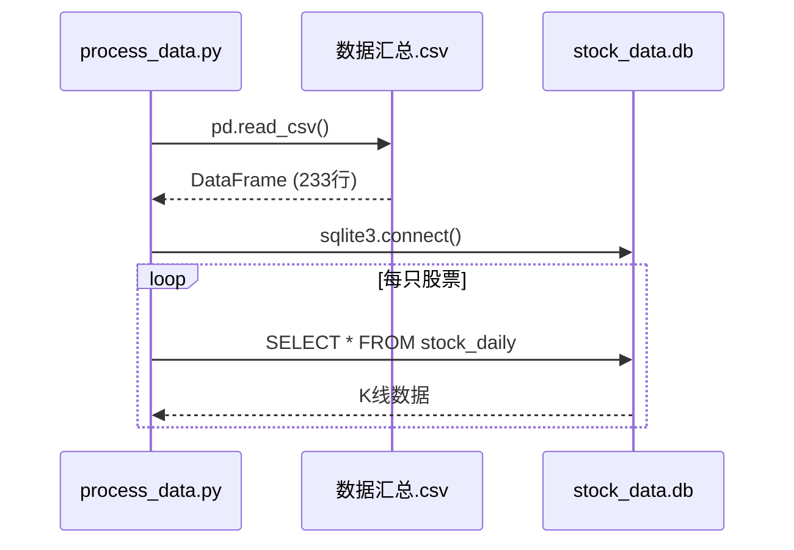

**读取代码**:
```python
# 读取CSV
df = pd.read_csv(CSV_FILE, encoding='utf-8')
df['入选日期+时间'] = pd.to_datetime(df['入选日期+时间'])

# 连接数据库
conn = sqlite3.connect(DB_FILE)
stock_df = pd.read_sql_query(query, conn)
```

### Phase 2: 代码格式转换

**问题**:
- CSV中代码: `300751`（6位纯数字）
- 数据库日线代码: `sz.003031`（带市场前缀）
- 数据库分钟线: `002466`（6位纯数字）

**解决方案**:
```python
def add_market_prefix(code):
    code_str = str(code).zfill(6)
    if code_str.startswith('6'):
        return f'sh.{code_str}'  # 上海证券交易所
    else:
        return f'sz.{code_str}'  # 深圳证券交易所
```

**匹配策略**:
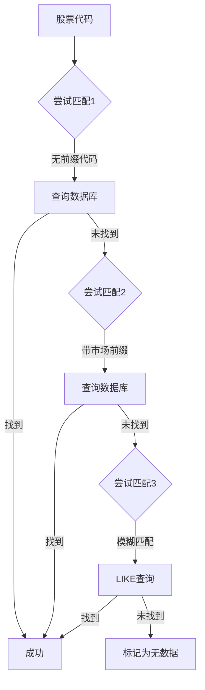

### Phase 3: 收益率计算

**计算公式**:
```
收益率 = (当前价格 - 买入价格) / 买入价格 × 100%
```

**买入价格确定**:
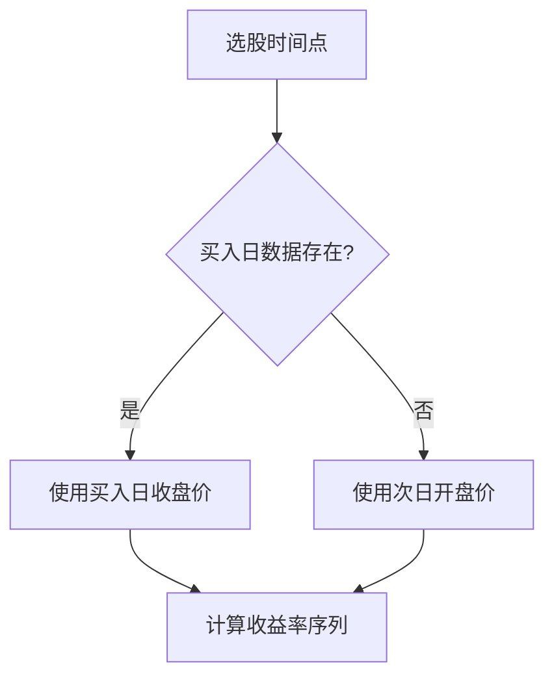

**计算代码**:
```python
# 找到买入日的收盘价
buy_day_data = stock_df[stock_df['date'] == buy_date]
if not buy_day_data.empty:
    actual_buy_price = buy_day_data.iloc[0]['close']
else:
    # 使用次日开盘价
    next_day_data = stock_df[stock_df['date'] > buy_date]
    actual_buy_price = next_day_data.iloc[0]['open']

# 计算收益率
stock_df['return_rate'] = (
    (stock_df['close'] - actual_buy_price) / actual_buy_price * 100
).round(2)
```

### Phase 4: 数据生成

**输出文件**: `src/backend/data/stock_returns.json`

**数据结构**:
```json
{
  "stats": {
    "total_stocks": 232,
    "with_data": 232,
    "avg_return": 13.94,
    "max_return": 201.39,
    "min_return": -28.24,
    "win_rate": 63.79
  },
  "stocks": [
    {
      "name": "迈为股份",
      "code": "300751",
      "buy_date": "2025-12-18 14:46",
      "buy_price": 157.51,
      "latest_price": 474.95,
      "return_rate": 201.39,
      "max_return": 201.39,
      "min_return": -2.85,
      "data_points": 30,
      "time_series": [
        {
          "date": "2025-12-18",
          "price": 157.51,
          "return_rate": 0.0
        }
      ]
    }
  ]
}
```

## 前端数据流

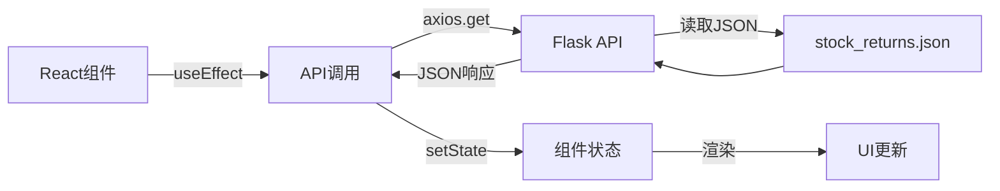

### 数据获取流程

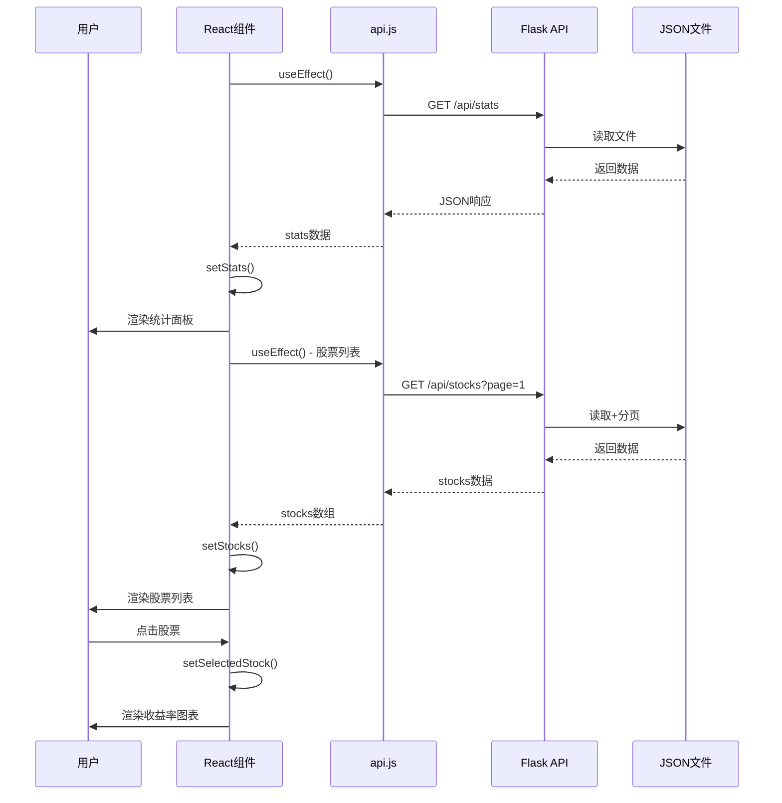

### 图表渲染流程

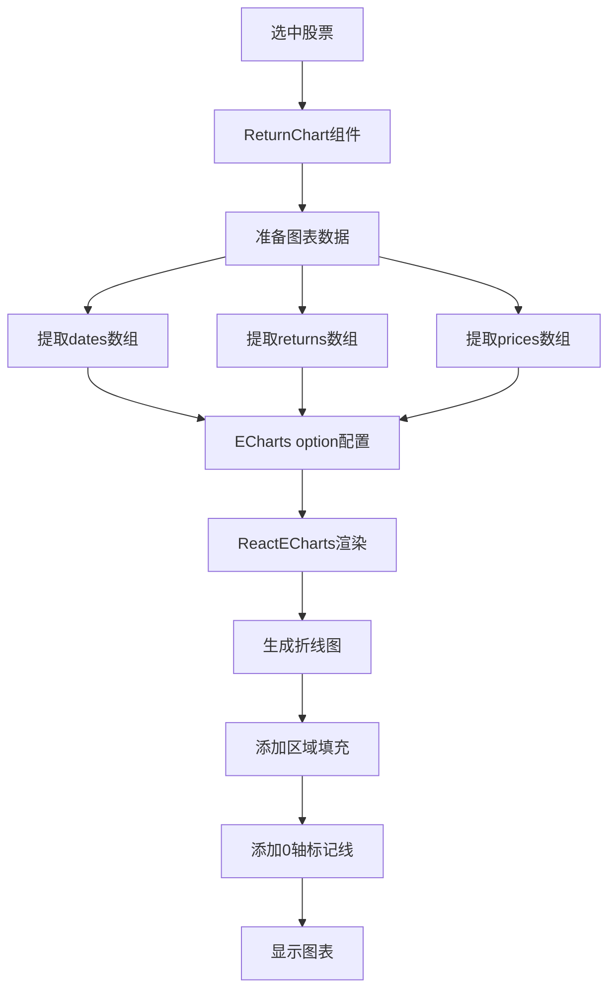

## API数据流

### 股票列表API流程

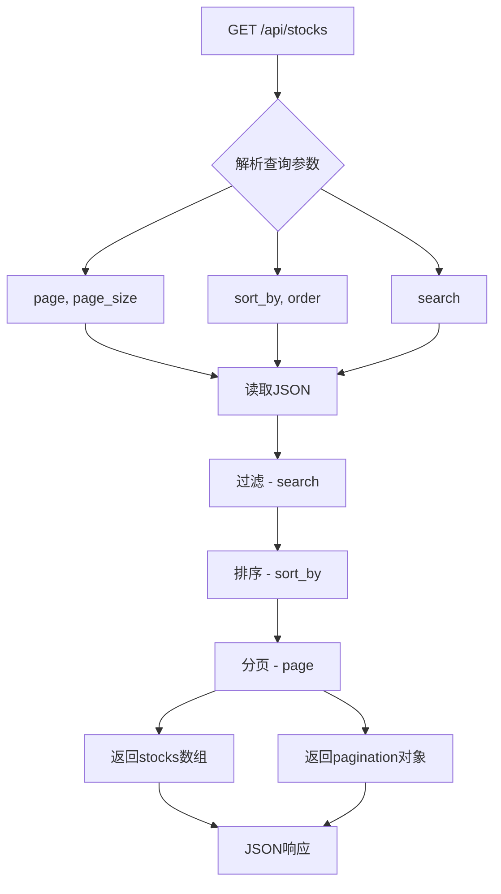

### 统计数据API流程

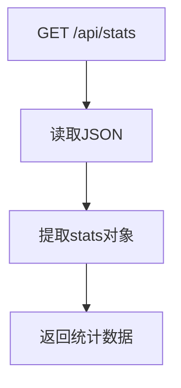

## 数据更新流程

### 数据更新触发条件

1. **新增选股数据**: 更新 `数据汇总.csv`
2. **更新K线数据**: 更新 `stock_data.db`
3. **定期更新**: 每日收盘后更新

### 更新步骤

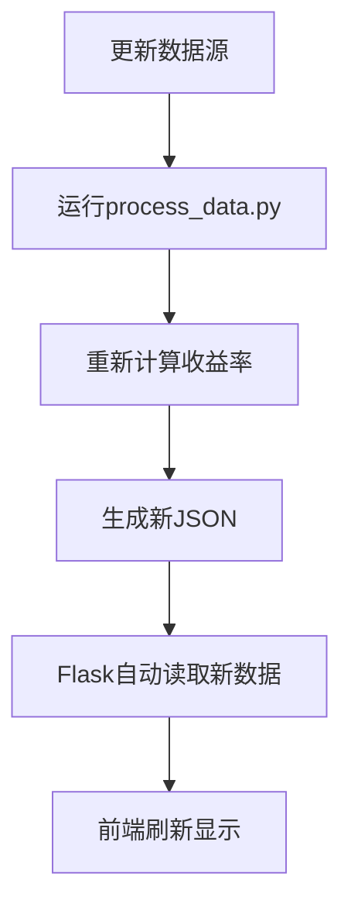

**更新命令**:
```bash
# 重新处理数据
source venv/bin/activate
python scripts/process_data.py

# 前端会自动获取最新数据（无需重启）
# Flask会重新读取JSON文件
```

## 数据质量保证

### 数据验证

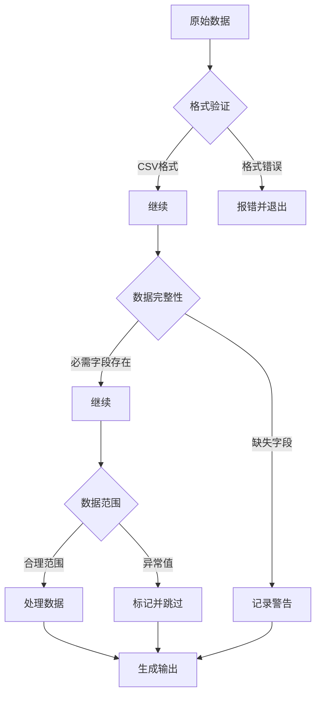

### 错误处理

**代码格式不匹配**:
```python
# 尝试多种格式
queries = [
    f"SELECT * FROM stock_daily WHERE code = '{code}'",
    f"SELECT * FROM stock_daily WHERE code = '{code_with_prefix}'",
    f"SELECT * FROM stock_daily WHERE code LIKE '%{code[-6:]}'"
]

for query in queries:
    df = pd.read_sql_query(query, conn)
    if not df.empty:
        return df

# 所有尝试都失败
print(f"警告: {name}({code}) 没有找到K线数据")
stats['without_data'] += 1
```

**时间数据异常**:
```python
# 确保时间格式正确
df['入选日期+时间'] = pd.to_datetime(df['入选日期+时间'])
stock_df['date'] = pd.to_datetime(stock_df['date'])
```

## 性能优化

### 数据处理优化

1. **预计算**: 收益率在数据处理阶段就计算好
2. **批量读取**: 一次性读取所有股票数据
3. **内存优化**: 使用 Pandas 的向量化操作

### API响应优化

1. **文件缓存**: JSON文件读取速度快于数据库
2. **分页**: 减少单次数据传输量
3. **数据精简**: 只返回前端需要的数据

### 前端渲染优化

1. **懒加载**: 图表只在选择股票后渲染
2. **分页**: 列表分页显示
3. **虚拟滚动**: 预留长列表优化

## 数据统计

### 处理结果统计

```
总股票数: 232
有数据: 232 (100%)
无数据: 0 (0%)
平均收益率: 13.94%
最高收益率: 201.39%
最低收益率: -28.24%
胜率: 63.79%
```

### 数据分布

**收益率分布**:
- 正收益: 148只 (63.79%)
- 负收益: 84只 (36.21%)
- 收益超过50%: 26只
- 收益超过100%: 5只

**时间分布**:
- 2025年10月: 32只
- 2025年11月: 54只
- 2025年12月: 89只
- 2026年1月: 57只

## 数据安全

### 备份策略

1. **原始数据备份**: 定期备份 `data/weipan/` 目录
2. **处理数据备份**: 保留多个版本的 JSON 文件
3. **版本控制**: 使用 Git 追踪代码和配置变更

### 数据隐私

- 不包含个人敏感信息
- 股票数据为公开信息
- 不存储用户操作记录

## 总结

本系统通过预计算和JSON缓存的方式，实现了高效的数据流转。数据处理流程清晰，具有良好的容错能力和扩展性。
