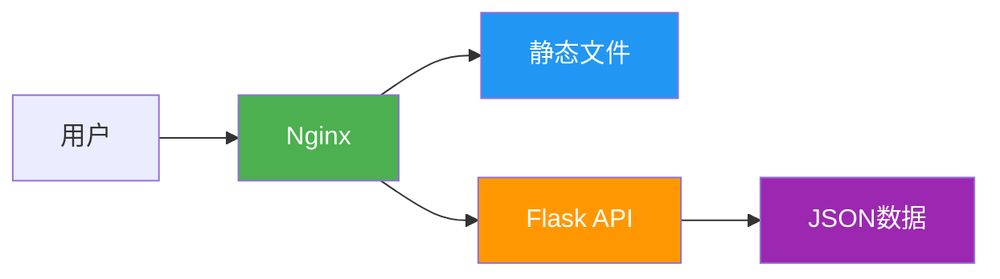

# 部署文档

## 概述

本文档介绍如何将股票收益率可视化系统部署到生产环境。

## 系统要求

### 最低配置

- **CPU**: 2核
- **内存**: 2GB
- **磁盘**: 10GB
- **操作系统**: Linux/macOS/Windows

### 软件要求

- **Node.js**: 18.0+
- **Python**: 3.8+
- **Web服务器**: Nginx（推荐）/ Apache

## 部署架构



## 部署方案

### 方案A: 单机部署（开发/测试）

适用于开发和小规模使用。

#### 步骤1: 准备环境

```bash
# 克隆项目（如果使用Git）
git clone <repository-url>
cd shareKLine

# 创建Python虚拟环境
python3 -m venv venv
source venv/bin/activate  # Linux/macOS
# 或
venv\Scripts\activate  # Windows

# 安装Python依赖
pip install flask flask-cors pandas
```

#### 步骤2: 处理数据

```bash
# 运行数据处理脚本
python scripts/process_data.py

# 检查生成的数据
cat src/backend/data/stock_returns.json
```

#### 步骤3: 启动后端

```bash
# 方式1: 直接运行（开发模式）
python src/backend/app.py

# 方式2: 使用启动脚本
chmod +x src/backend/start.sh
./src/backend/start.sh

# 方式3: 使用 Gunicorn（生产推荐）
pip install gunicorn
gunicorn -w 4 -b 0.0.0.0:5000 src.backend.app:app
```

#### 步骤4: 构建前端

```bash
cd src/frontend

# 安装依赖
npm install

# 构建生产版本
npm run build

# 构建产物在 dist/ 目录
```

#### 步骤5: 启动前端（开发模式）

```bash
cd src/frontend
npm run dev
```

访问: http://localhost:5173

---

### 方案B: 生产部署（推荐）

适用于正式生产环境。

#### 1. 使用Nginx部署

**安装Nginx**:
```bash
# Ubuntu/Debian
sudo apt install nginx

# CentOS/RHEL
sudo yum install nginx

# macOS
brew install nginx
```

**配置Nginx** (`/etc/nginx/sites-available/sharekline`):

```nginx
# 后端API反向代理
upstream flask_backend {
    server 127.0.0.1:5000;
}

# 前端静态文件
server {
    listen 80;
    server_name your-domain.com;

    # 前端静态文件
    location / {
        root /path/to/shareKLine/src/frontend/dist;
        try_files $uri $uri/ /index.html;
    }

    # API代理
    location /api/ {
        proxy_pass http://flask_backend;
        proxy_set_header Host $host;
        proxy_set_header X-Real-IP $remote_addr;
        proxy_set_header X-Forwarded-For $proxy_add_x_forwarded_for;
        proxy_set_header X-Forwarded-Proto $scheme;
    }

    # 启用gzip压缩
    gzip on;
    gzip_types text/plain text/css application/json application/javascript text/xml application/xml;
}
```

**启用配置**:
```bash
# 创建软链接
sudo ln -s /etc/nginx/sites-available/sharekline /etc/nginx/sites-enabled/

# 测试配置
sudo nginx -t

# 重启Nginx
sudo systemctl restart nginx
```

#### 2. 使用Systemd管理Flask

创建服务文件 (`/etc/systemd/system/sharekline-api.service`):

```ini
[Unit]
Description=ShareKLine Flask API
After=network.target

[Service]
User=www-data
WorkingDirectory=/path/to/shareKLine
Environment="PATH=/path/to/shareKLine/venv/bin"
ExecStart=/path/to/shareKLine/venv/bin/gunicorn -w 4 -b 127.0.0.1:5000 src.backend.app:app
Restart=always

[Install]
WantedBy=multi-user.target
```

**启动服务**:
```bash
# 重载systemd配置
sudo systemctl daemon-reload

# 启动服务
sudo systemctl start sharekline-api

# 开机自启
sudo systemctl enable sharekline-api

# 查看状态
sudo systemctl status sharekline-api

# 查看日志
sudo journalctl -u sharekline-api -f
```

#### 3. 使用PM2管理Flask

```bash
# 安装PM2
npm install -g pm2

# 创建ecosystem.config.js
cat > ecosystem.config.js << EOF
module.exports = {
  apps: [{
    name: 'sharekline-api',
    script: 'venv/bin/gunicorn',
    args: '-w 4 -b 127.0.0.1:5000 src.backend.app:app',
    cwd: '/path/to/shareKLine',
    instances: 1,
    autorestart: true,
    watch: false,
    max_memory_restart: '1G',
    env: {
      NODE_ENV: 'production'
    }
  }]
};
EOF

# 启动应用
pm2 start ecosystem.config.js

# 开机自启
pm2 startup
pm2 save
```

---

### 方案C: Docker部署

使用Docker容器化部署，便于管理和扩展。

#### 1. 创建Dockerfile

**后端Dockerfile** (`Dockerfile.backend`):

```dockerfile
FROM python:3.11-slim

WORKDIR /app

# 安装系统依赖
RUN apt-get update && apt-get install -y \
    gcc \
    && rm -rf /var/lib/apt/lists/*

# 复制依赖文件
COPY requirements.txt .
RUN pip install --no-cache-dir -r requirements.txt

# 复制应用代码
COPY . .

# 暴露端口
EXPOSE 5000

# 启动命令
CMD ["gunicorn", "-w", "4", "-b", "0.0.0.0:5000", "src.backend.app:app"]
```

**前端Dockerfile** (`Dockerfile.frontend`):

```dockerfile
FROM node:18-alpine as builder

WORKDIR /app

# 复制依赖文件
COPY src/frontend/package*.json ./
RUN npm install

# 复制源代码并构建
COPY src/frontend/ ./
RUN npm run build

# 生产镜像
FROM nginx:alpine
COPY --from=builder /app/dist /usr/share/nginx/html
COPY nginx.conf /etc/nginx/conf.d/default.conf

EXPOSE 80
```

#### 2. 创建docker-compose.yml

```yaml
version: '3.8'

services:
  backend:
    build:
      context: .
      dockerfile: Dockerfile.backend
    container_name: sharekline-api
    ports:
      - "5000:5000"
    volumes:
      - ./src/backend/data:/app/src/backend/data
    restart: always

  frontend:
    build:
      context: .
      dockerfile: Dockerfile.frontend
    container_name: sharekline-frontend
    ports:
      - "80:80"
    depends_on:
      - backend
    restart: always
```

#### 3. 启动服务

```bash
# 构建并启动
docker-compose up -d

# 查看日志
docker-compose logs -f

# 停止服务
docker-compose down

# 重启服务
docker-compose restart
```

---

### 方案D: 云平台部署

#### Vercel部署（前端）

```bash
# 安装Vercel CLI
npm install -g vercel

# 登录
vercel login

# 部署
cd src/frontend
vercel

# 生产部署
vercel --prod
```

#### Railway/Render部署（全栈）

1. 连接GitHub仓库
2. 选择自动部署
3. 配置环境变量
4. 部署完成

---

## 环境变量配置

创建 `.env` 文件：

```bash
# Flask配置
FLASK_ENV=production
FLASK_DEBUG=0
SECRET_KEY=your-secret-key

# API配置
API_HOST=0.0.0.0
API_PORT=5000
API_BASE_URL=http://localhost:5000/api

# 数据路径
DATA_DIR=/path/to/data
JSON_FILE=/path/to/src/backend/data/stock_returns.json

# 日志配置
LOG_LEVEL=INFO
LOG_FILE=/var/log/sharekline/app.log
```

修改Flask代码以支持环境变量：

```python
import os
from dotenv import load_dotenv

load_dotenv()

API_HOST = os.getenv('API_HOST', '0.0.0.0')
API_PORT = os.getenv('API_PORT', 5000)

if __name__ == '__main__':
    app.run(host=API_HOST, port=API_PORT)
```

---

## 数据更新部署

### 自动化更新脚本

创建 `scripts/update_and_restart.sh`:

```bash
#!/bin/bash

echo "开始更新数据..."

# 激活虚拟环境
source /path/to/shareKLine/venv/bin/activate

# 处理数据
python /path/to/shareKLine/scripts/process_data.py

# 重启Flask服务
pm2 restart sharekline-api
# 或
sudo systemctl restart sharekline-api

echo "数据更新完成！"
```

设置定时任务（Cron）：

```bash
# 编辑crontab
crontab -e

# 每天下午3点执行更新
0 15 * * 1-5 /path/to/shareKLine/scripts/update_and_restart.sh >> /var/log/sharekline/update.log 2>&1
```

---

## 性能优化

### 1. 启用Gzip压缩

**Nginx配置**:
```nginx
gzip on;
gzip_vary on;
gzip_min_length 1024;
gzip_types text/plain text/css application/json application/javascript text/xml;
```

### 2. 静态资源CDN

将静态资源上传到CDN，修改前端配置。

### 3. 启用缓存

**Nginx配置**:
```nginx
location ~* \.(jpg|jpeg|png|gif|ico|css|js)$ {
    expires 1y;
    add_header Cache-Control "public, immutable";
}
```

---

## 监控与日志

### 日志配置

**Flask日志** (`src/backend/app.py`):

```python
import logging
from logging.handlers import RotatingFileHandler

# 配置日志
handler = RotatingFileHandler('app.log', maxBytes=10000, backupCount=3)
handler.setLevel(logging.INFO)
app.logger.addHandler(handler)
```

### 监控工具

- **Prometheus + Grafana**: 性能监控
- **Sentry**: 错误追踪
- **Uptime Robot**: 服务可用性监控

---

## 安全加固

### 1. 防火墙配置

```bash
# UFW (Ubuntu)
sudo ufw allow 80/tcp
sudo ufw allow 443/tcp
sudo ufw enable

# iptables
sudo iptables -A INPUT -p tcp --dport 80 -j ACCEPT
sudo iptables -A INPUT -p tcp --dport 443 -j ACCEPT
```

### 2. HTTPS配置

使用Let's Encrypt免费证书：

```bash
# 安装certbot
sudo apt install certbot python3-certbot-nginx

# 获取证书
sudo certbot --nginx -d your-domain.com

# 自动续期
sudo certbot renew --dry-run
```

### 3. 限流配置

**Nginx限流**:

```nginx
http {
    limit_req_zone $binary_remote_addr zone=api:10m rate=10r/s;

    location /api/ {
        limit_req zone=api burst=20;
        # ... 其他配置
    }
}
```

---

## 备份策略

### 数据备份

```bash
#!/bin/bash
# backup.sh

DATE=$(date +%Y%m%d_%H%M%S)
BACKUP_DIR="/path/to/backups"

# 备份数据文件
tar -czf $BACKUP_DIR/data_$DATE.tar.gz data/

# 备份代码
tar -czf $BACKUP_DIR/code_$DATE.tar.gz src/

# 保留最近30天的备份
find $BACKUP_DIR -name "*.tar.gz" -mtime +30 -delete
```

### 自动备份

```bash
# 添加到crontab
0 2 * * * /path/to/backup.sh
```

---

## 故障排除

### 常见问题

**1. 端口被占用**
```bash
# 查看端口占用
lsof -i :5000
netstat -tulpn | grep :5000

# 杀死进程
kill -9 <PID>
```

**2. 权限问题**
```bash
# 修改文件权限
sudo chown -R www-data:www-data /path/to/shareKLine
chmod -R 755 /path/to/shareKLine
```

**3. 依赖问题**
```bash
# 重新安装依赖
pip install --upgrade -r requirements.txt
npm install --force
```

---

## 更新部署

### 滚动更新步骤

1. 备份当前版本
2. 更新代码
3. 更新依赖
4. 处理数据
5. 重启服务
6. 验证功能

### 回滚策略

```bash
# 停止服务
pm2 stop sharekline-api

# 恢复备份
cp -r backup/old_version/* /path/to/shareKLine/

# 重启服务
pm2 start sharekline-api
```

---

## 总结

本部署文档提供了从开发到生产的完整部署方案。根据实际需求选择合适的部署方案，建议生产环境使用Nginx + Gunicorn + Systemd的组合。

部署检查清单：
- [ ] 环境准备完成
- [ ] 依赖安装完成
- [ ] 数据处理成功
- [ ] 后端服务启动
- [ ] 前端构建成功
- [ ] Nginx配置完成
- [ ] HTTPS证书安装
- [ ] 防火墙配置
- [ ] 监控配置
- [ ] 备份策略配置
