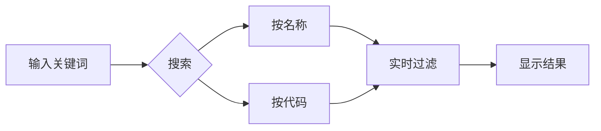
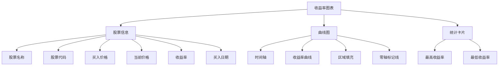

# 用户手册

## 概述

欢迎使用股票收益率可视化系统！本手册将帮助您快速上手并充分利用系统的各项功能。

## 系统简介

股票收益率可视化系统是一个基于选股数据的收益率分析工具，可以：
- 📊 查看每只股票从买入时间点后的收益率曲线
- 📈 了解整体投资统计数据
- 🔍 搜索和筛选股票
- 📱 在多种设备上使用

## 快速开始

### 首次使用

1. **打开系统**
   - 在浏览器中访问系统地址
   - 本地开发：http://localhost:5173
   - 生产环境：您的域名

2. **了解界面**
   - 顶部：系统标题和简介
   - 统计面板：6个关键指标卡片
   - 左侧：股票列表（表格）
   - 右侧：收益率图表

3. **查看数据**
   - 系统会自动加载所有股票数据
   - 默认按收益率从高到低排序

---

## 功能详解

### 1. 统计面板

统计面板位于页面顶部，显示6个关键指标：

| 指标 | 说明 | 示例 |
|------|------|------|
| **总股票数** | 选股总数 | 232 |
| **有数据** | 有K线数据的股票数 | 232 |
| **平均收益率** | 所有股票的平均收益率 | +13.94% |
| **最高收益率** | 表现最好的股票收益 | +201.39% |
| **最低收益率** | 表现最差的股票收益 | -28.24% |
| **胜率** | 盈利股票占比 | 63.79% |

**颜色含义**：
- 🟢 绿色：正向指标（盈利）
- 🔴 红色：负向指标（亏损）
- 🔵 蓝色：中性指标

---

### 2. 股票列表

股票列表以表格形式展示所有股票信息。

#### 列说明

| 列名 | 说明 | 示例 |
|------|------|------|
| **代码** | 股票代码 | 300751 |
| **名称** | 股票名称 | 迈为股份 |
| **买入价** | 买入时的价格 | ¥157.51 |
| **现价** | 最新价格 | ¥474.95 |
| **收益率** | 当前收益率 | +201.39% |
| **最高** | 历史最高收益率 | +201.39% |
| **最低** | 历史最低收益率 | -2.85% |
| **买入日期** | 买入时间 | 2025-12-18 14:46 |

#### 交互操作

**查看详情**：
- 点击表格中的任意一行
- 右侧会显示该股票的收益率曲线图
- 选中的行会高亮显示（蓝色背景）

---

### 3. 搜索功能

在搜索框中输入关键词，实时过滤股票列表。

#### 支持的搜索方式

- **按名称搜索**：输入"迈为"，找到"迈为股份"
- **按代码搜索**：输入"300751"，找到对应股票
- **模糊匹配**：输入部分关键词

#### 使用场景



**示例**：
- 查找"比亚迪"：输入"比亚迪"
- 查找特定板块：输入"科技"
- 查找代码前几位：输入"300"

---

### 4. 排序功能

点击排序按钮，对股票列表进行排序。

#### 可排序字段

| 按钮 | 字段 | 说明 |
|------|------|------|
| **收益率** | return_rate | 当前收益率 |
| **名称** | name | 股票名称 |
| **买入日期** | buy_date | 买入时间 |

#### 排序方向

- **降序（↓）**：从高到低
- **升序（↑）**：从低到高

**使用场景**：
- 查看表现最好的股票：按收益率降序
- 查看最近买入的股票：按买入日期降序
- 按名称查找：按名称升序

---

### 5. 分页功能

当股票数量较多时，使用分页浏览。

#### 分页控制

- **上一页**：返回前一页
- **页码显示**：当前页/总页数
- **下一页**：前往下一页

**默认设置**：
- 每页显示：50条
- 总页数：根据数据量自动计算

---

### 6. 收益率图表

选择股票后，右侧显示收益率曲线图。

#### 图表组成



#### 图表交互

**悬停提示**：
- 鼠标移动到曲线上
- 显示具体日期和收益率数值

**缩放**：
- 鼠标滚轮缩放时间范围
- 拖动平移查看不同时间段

**重置**：
- 右键点击图表
- 选择"还原"恢复初始视图

#### 图表解读

- **曲线向上**：收益率增长（盈利）
- **曲线向下**：收益率下降（亏损）
- **曲线平缓**：收益率变化小
- **零轴（红色线）**：盈亏分界线
- **曲线颜色**：蓝色
- **区域填充**：蓝色渐变

---

## 使用场景

### 场景1：查看整体投资表现

**步骤**：
1. 打开系统
2. 查看顶部统计面板
3. 了解平均收益率、胜率等关键指标

**解读**：
- 平均收益率 > 0：整体盈利
- 胜率 > 60%：选股质量较好
- 最高/最低收益率：了解风险范围

---

### 场景2：找到表现最好的股票

**步骤**：
1. 确认排序按钮显示"收益率 ↓"
2. 如果不是，点击"收益率"按钮切换到降序
3. 查看表格第一行

**结果**：
- 表格第一行就是收益率最高的股票
- 当前数据：迈为股份（+201.39%）

---

### 场景3：分析单只股票表现

**步骤**：
1. 在搜索框输入股票名称或代码
2. 点击表格中的该股票行
3. 查看右侧收益率图表

**分析要点**：
- 当前收益率：正数为盈利，负数为亏损
- 最高/最低收益率：了解波动范围
- 曲线趋势：上升或下降
- 时间跨度：持有多长时间

---

### 场景4：查找特定时间买入的股票

**步骤**：
1. 点击"买入日期"排序按钮
2. 选择降序（↓）查看最近买入的
3. 或选择升序（↑）查看最早买入的

**应用**：
- 查看最近选股的表现
- 分析不同时期的选股质量

---

### 场景5：对比多只股票

**步骤**：
1. 点击第一只股票查看图表
2. 记录关键数据（收益率、最高/最低）
3. 点击第二只股票查看图表
4. 对比分析

**对比指标**：
- 最终收益率
- 最高收益率
- 最低收益率
- 曲线稳定性

---

## 数据解读指南

### 收益率解读

| 收益率范围 | 评级 | 说明 |
|-----------|------|------|
| > 50% | 优秀 | 表现非常好 |
| 20% - 50% | 良好 | 表现不错 |
| 0% - 20% | 一般 | 小幅盈利 |
| -20% - 0% | 较差 | 小幅亏损 |
| < -20% | 差 | 表现不佳 |

### 风险评估

**低风险**：
- 最低收益率 > -10%
- 曲线波动小

**中风险**：
- 最低收益率 -10% ~ -20%
- 曲线有波动

**高风险**：
- 最低收益率 < -20%
- 曲线波动大

### 时间因素

- **短期（< 1个月）**：参考价值有限
- **中期（1-3个月）**：有一定参考价值
- **长期（> 3个月）**：参考价值较高

---

## 常见问题

### Q1: 为什么有些股票没有数据？

**A**: 可能原因：
1. 数据库中没有该股票的K线数据
2. 代码格式不匹配
3. 数据时间范围不在选股时间后

**解决**：检查数据库更新，确保数据完整。

---

### Q2: 收益率是如何计算的？

**A**: 计算公式：
```
收益率 = (当前价格 - 买入价格) / 买入价格 × 100%
```

**买入价格确定**：
- 优先使用买入日收盘价
- 如果没有，使用次日开盘价

---

### Q3: 数据更新频率？

**A**:
- **实时更新**：否
- **手动更新**：运行数据处理脚本
- **建议**：每日收盘后更新一次

---

### Q4: 图表无法显示？

**A**: 检查：
1. 是否选择了股票
2. 浏览器控制台是否有错误
3. 网络连接是否正常
4. 刷新页面重试

---

### Q5: 搜索不到股票？

**A**: 确认：
1. 关键词输入正确
2. 股票存在于数据库中
3. 清空搜索框重试

---

## 最佳实践

### 1. 定期查看统计数据

- 每周查看一次平均收益率变化
- 关注胜率趋势
- 了解整体投资表现

### 2. 关注极端情况

- 定期查看最高/最低收益率股票
- 分析成功/失败案例
- 总结经验教训

### 3. 对比分析

- 对比不同时期的选股表现
- 对比相似股票的收益差异
- 找出规律和模式

### 4. 数据验证

- 定期检查数据准确性
- 对比实际交易记录
- 发现问题及时反馈

---

## 快捷键（未来功能）

| 快捷键 | 功能 | 状态 |
|--------|------|------|
| `/` | 聚焦搜索框 | 待实现 |
| `Ctrl+F` | 搜索 | 待实现 |
| `↑` `↓` | 选择股票 | 待实现 |
| `Enter` | 查看详情 | 待实现 |
| `Esc` | 清除搜索 | 待实现 |

---

## 移动端使用

### 响应式布局

系统支持移动端访问，自动适配屏幕大小。

**移动端特点**：
- 单列布局
- 触摸滑动查看表格
- 图表自动缩放
- 优化的按钮大小

**推荐使用**：
- 平板：横屏使用体验最佳
- 手机：竖屏浏览

---

## 导出功能（未来）

**计划支持**：
- 导出股票列表为 CSV
- 导出图表为图片
- 导出统计报告为 PDF

---

## 技术支持

### 遇到问题？

1. **查看文档**：先查阅相关文档
2. **检查日志**：查看浏览器控制台错误
3. **联系管理员**：提供详细问题描述

### 反馈渠道

- GitHub Issues
- 邮件支持
- 在线客服

---

## 更新日志

### v1.0.0 (2026-01-31)

**初始版本功能**：
- ✅ 股票列表展示
- ✅ 收益率计算
- ✅ 统计面板
- ✅ 搜索功能
- ✅ 排序功能
- ✅ 分页功能
- ✅ 收益率图表
- ✅ 响应式设计

**即将推出**：
- ⏳ 数据导出
- ⏳ 自定义时间范围
- ⏳ 多股票对比
- ⏳ 预警功能

---

## 总结

本系统是一个简单易用的股票收益率分析工具。通过本手册，您应该能够：
- ✅ 了解系统各项功能
- ✅ 快速找到需要的数据
- ✅ 正确解读收益率信息
- ✅ 解决常见问题

祝您投资顺利！
